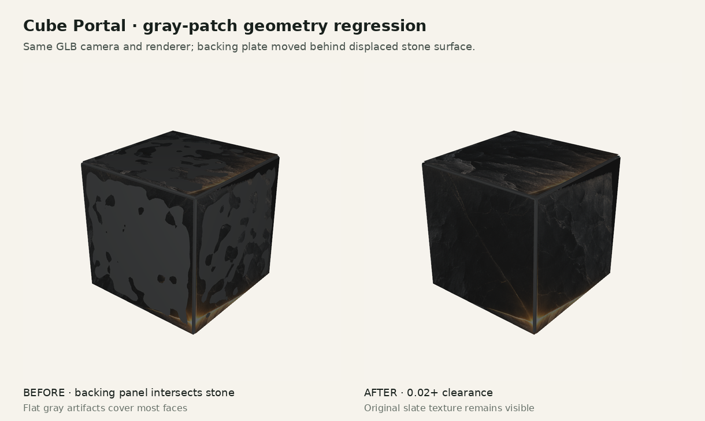

# Cube Portal React preview

This is an **isolated review route**, not the published homepage. The prototype's GLB model and fallback image are reused from `prototypes/unfolding-cube-portal/assets/` through Vite `?url` imports; no assets are duplicated.

## Preview

From `frontend/` run:

```powershell
npm.cmd install --no-audit --no-fund
npm.cmd run dev -- --host 127.0.0.1
```

Open `http://127.0.0.1:5173/cube-preview`, select Work, return via Escape/Back/Return, toggle the theme, then compare desktop and mobile. Verify in Firefox on Windows (WebGL2-enabled), not just the fallback.

Static checks: `node --test tests/cube-preview.test.mjs`. Production build: `npm.cmd run build`.

## Boundaries

- `/` remains the original React homepage, including Backend Lab's configuration/auth behavior.
- `/galaxy` remains its separately lazy-loaded React/WebGL experience.
- `/about` remains the static canonical biography page.
- `/cube-preview` is `noindex` at runtime and uses fragment history for `#work`. It does not add an indexed canonical page.
- Lab, Galaxy, and About links intentionally take visitors to their already deployed experiences; only Work unfolds within the preview.
- No deployment or automatic switch of `/` to this preview is part of this phase.

## WebGL acceptance (unverified until tested on owner hardware)

Open Firefox Developer Tools Console and verify no WebGL, GLB loading, CSP, or 404 errors. Check that the actual cube faces move while Work opens and that the overlay emerges from the cube's center; confirm the seam's lighting is convincing in both themes. Test at 390px width and with Windows **Settings → Accessibility → Visual effects → Animation effects off** (or browser `prefers-reduced-motion: reduce`). Test Back/Forward and pressing Escape during the transition. Device performance/thermals remain unverified until measured.

## Implementation

- `CubePortal.jsx` — route shell, theme, accessible Work chapter, URL and focus restoration.
- `cubePortalNavigation.js` — pure route and motion rules.
- `CubeScene.jsx` — lazy 3D renderer lifetime and static fallback.
- `createCubeScene.js` — Three.js GLTFLoader, independent face transforms, bounded DPR, on-demand rendering, cleanup on unmount.
- `CubePortal.css` — isolated light/dark visual system and mobile/reduced-motion adaptations.

The cube is not yet a production-ready replacement for the homepage. This route is the integration and visual acceptance gate.

## Gray-patch regression evidence (2026-11-24)

The original GLB had its six flat backing plates intersecting displaced stone surfaces, producing gray patches when rendered. The model source now enforces backing-plate clearance, and `tests/cube-model-clearance.test.mjs` checks all six faces against the exported GLB.



The image is a **controlled off-screen VTK GLB render** at the same camera position for the old and corrected models. The corrected GLB is the exact Git blob used by this PR (`1dc67ff8d6478549e3b3d3881e8e2e109483f5aa`). Independent rendered evidence confirms the large flat gray regions disappear. The per-face backing clearances range from 0.020 to 0.024 model units.

**Still pending:** screenshot/video of the **React Three.js renderer in Firefox** with WebGL2 on the owner’s GPU; the off-screen result is not a replacement for that test. Vercel’s PR preview requires authentication for automated browser inspection. Do not merge the homepage cutover on the strength of off-screen evidence alone.

## Browser and motion evidence (2026-11-24)

- **Passed**: GitHub Actions `Cube Portal WebGL Visual Capture` run `45242427451`, on source commit `519d7397`, in headless Chromium on Ubuntu 24.04. The test confirmed WebGL2, GLB HTTP 200, no image fallback, real light/dark rendering, desktop and mobile Work opening, Escape/Back, no horizontal overflow or browser errors, and reduced-motion navigation.
- **Motion refinement**: the page mask originally covered ~85% of the viewport radius just ~320 ms into opening. The current slower-start easing leaves the cube scene visible longer; the browser probe measured ~0.4% desktop and ~10.9% mobile in the sampled early frame. The recorded videos and screenshots are stored in the run’s `cube-portal-webgl-visual` artifact (seven-day retention). This is an animation timing proof, not an FPS or physical-GPU benchmark.
- **Remaining**: Firefox on the owner’s Windows GPU, thermal/performance testing on a real machine, touch behavior on a physical phone, and final visual sign-off before any homepage cutover.

## Material replacement — pbr-stone-v3 (2026-11-24)

A controlled comparison of full-model and `?cubeMode=stone-only&cubeDebug=1` captures showed that hiding backing shells changed around 1% of cube pixels (primarily edges). Shells therefore do **not** explain the unsatisfactory flat/dark stone appearance. The React preview now loads a **new GLB asset filename** (`stone-cube-pbr-v3.glb`): neutral charcoal base-color, generated tangent-space normal maps, displaced stone surface, and a separate emissive gold seam on the top panel. It no longer relies on perspective-warped highlights from the earlier 2D concept image. The six face names and the existing opening choreography remain unchanged.

Source: `prototypes/unfolding-cube-portal/source/build_model_pbr.py` (deterministic generated maps, no external asset license). The legacy GLB remains for the standalone prototype, but the React route references only v3. Verify final appearance in GitHub's WebGL capture artifact and on the owner's Firefox GPU before considering a homepage cutover.

## Current acceptance — canonical-stone-v1 (2026-11-24)

The canonical model in source commit `3c5860570beee3348d3677223dc10ed27ec0f465` supersedes the previous material trial for the React preview. It uses corrected UVs, original artwork-derived texture detail, a matching fallback shown only after a load error, first-frame visibility, destination highlight and a single moving lid. The older assets are preserved for prototype/history, not loaded on the normal preview path.

Frontend CI run `45331847092` and Vercel preview succeeded. The visual run `45331847044` was interrupted twice, once by a runner shutdown and again by cancellation without retained logs/artifacts. This is **not** a browser acceptance pass or proof of an app defect. The capture workflow now separates desktop/mobile/reduced-motion into independent jobs, bounds individual waits, logs milestones and saves results before closing video. Current acceptance requires a completed canonical-model browser run and owner visual approval in Firefox. No new visual variants or homepage changes in this phase.

## Artwork prototype — original-artwork-v1 (2026-11-24)

Owner's Firefox screenshot confirmed that canonical-stone-v1 was loaded, but the projected GLB still lacked the original stone and seam fidelity. The default preview now uses the exact existing transparent `source/reference-cube.png` (Git blob `33c6c4a293b3f23550e5a1315d6928d344f56569`). Idle uses the uncut image. During opening/closing, clipped SVG views of the same image separate along the original top seam; the body stays fixed. No GLB/Three.js initialization, loading-image swap, or GPU-specific material is needed for this route. The previous renderer and model are retained in the repository for rollback, but not loaded by the artwork preview. This is a fixed-view 2.5D effect, not a physically rotating 3D object. Existing destinations, theme, Work navigation and reduced-motion contracts are preserved. Browser matrix and owner visual sign-off pending.

## Final interaction refinement — original-artwork-tilt-v2

The owner chose to stop native Blender modeling and retain the exact artwork preview. A desktop fine-mouse pointer can tilt the existing SVG artwork up to 7 degrees in either axis. This is CSS perspective, not free 3D rotation. The same image and clipping paths remain in use; no new assets, Three.js runtime or model switching. Tilt resets on pointer exit, blur, phase change and pointer cancellation; touch and reduced-motion remain stationary. The previous Blender study is retained on its independent experiment branch. Browser retest and owner visual approval are required before freezing the design.
